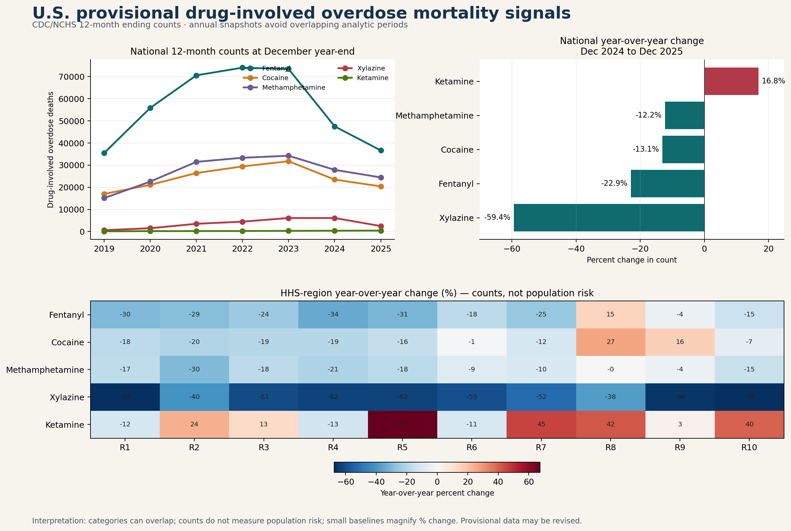

# Provisional Drug-Involved Overdose Mortality Signals



## Executive summary

National progress can conceal substances or regions moving in the opposite direction. This project uses **11,088 CDC/NCHS records** to compare provisional drug-involved overdose death counts across 12 drug categories, the United States, and 10 HHS regions.

For the 12-month period ending December 2025, **fentanyl remained the largest tracked category at 36,627 deaths**, although its provisional count was **22.9% lower** than in the comparable December 2024 period. **Xylazine had the steepest national decline (−59.4%)**. **Ketamine increased 16.8% nationally**, while cocaine increased **26.8% in HHS Region 8** and **16.3% in Region 9** despite a **13.1% national decline**.

The workflow pairs Python with a substantive SAS validation program. It is a descriptive surveillance analysis—not a population-risk comparison, causal analysis, or evaluation of a program or policy.

## Decision question

**Which drug-involvement signals changed most in the latest comparable 12-month periods, and where did HHS regional patterns differ from the national direction?**

**Audience:** overdose-surveillance teams, epidemiologists, public-health planners, healthcare analysts, and recruiters evaluating reproducible SAS/Python work.

**Use case:** identify drug categories and regions that merit deeper review with final mortality rates, toxicology context, timelier nonfatal-overdose indicators, and local program knowledge.

## Why the comparison is designed this way

CDC reports rolling 12-month counts. Consecutive monthly values share 11 months, so treating them as independent observations would overstate the amount of new information. The primary comparison uses December 2025 versus December 2024: adjacent, non-overlapping annual periods with the same seasonal coverage.

## Key findings

| Signal | December 2025 count | Change from December 2024 |
|---|---:|---:|
| Fentanyl | 36,627 | −22.9% |
| Methamphetamine | 24,442 | −12.2% |
| Cocaine | 20,387 | −13.1% |
| Xylazine | 2,483 | −59.4% |
| Ketamine | 430 | +16.8% |

- Major tracked categories declined nationally, but not uniformly across HHS regions.
- Region 8 cocaine counts increased 26.8%, Region 9 cocaine counts increased 16.3%, and Region 8 fentanyl counts increased 15.2%.
- The seven-snapshot exploratory log-linear model estimated a long-run decline for heroin (−29.7% per year; 95% CI −33.3% to −26.0%) and an increase for ketamine (+23.3%; 95% CI +15.4% to +31.6%). Constant-slope trend estimates are secondary and should be interpreted cautiously.
- Numeric counts were available for 10,625 of 11,088 records (95.8%); suppressed or unavailable values were not imputed.

## Methods at a glance

```text
CDC/NCHS Socrata API + dataset metadata
                │
                ▼
Python acquisition + SHA-256 manifest
                │
                ▼
Typed cleaning + grain/range/completeness QA
                │
                ├── National year-over-year signals
                ├── HHS-region divergence table
                ├── U.S.–region reconciliation
                └── Exploratory log-linear trends
                │
                ▼
Dashboard + machine-readable tables
                │
                ▼
Independent SAS import, QA, summaries and model
```

The 12 drug categories are **not mutually exclusive**. A death involving multiple listed drugs can contribute to more than one category. Counts are not population-adjusted rates.

## Reproduce the analysis

### Python

Requirements: Python 3.12+ and internet access for acquisition.

```powershell
git clone https://github.com/gorkira28/provisional-overdose-drug-signals.git
cd provisional-overdose-drug-signals
python -m venv .venv
.venv\Scripts\Activate.ps1
pip install -r requirements.txt
python python/acquire_and_analyze.py
python tests/test_outputs.py
```

Or run `./run_pipeline.ps1` from PowerShell.

### SAS Studio / SAS OnDemand

1. Run the Python workflow or download the complete repository.
2. Upload the repository to SAS Studio or SAS OnDemand for Academics.
3. Open `sas/overdose_signal_analysis.sas`.
4. Change the `project_path` macro variable to the uploaded directory.
5. Run the program and review the log for the embedded `PASS` checks.

The SAS program independently imports and types the raw CDC CSV, validates row grain and dimensions, recreates national and regional change tables, checks six headline counts, fits the companion log-linear model with `PROC REG`, and exports SAS results for comparison.

## Repository structure

```text
├── data/
│   ├── raw/                  # Date-stamped CDC extract, metadata, checksums
│   └── processed/            # Typed full data and annual snapshots
├── docs/                     # Methods, dictionary, references, publication drafts
├── outputs/
│   ├── figures/              # Recruiter-ready dashboard
│   └── tables/               # Signals, models, QA and reconciliation
├── python/                   # Acquisition, cleaning, analysis and visualization
├── sas/                      # Independent SAS validation and model workflow
├── tests/                    # Reproducibility assertions
└── run_pipeline.ps1
```

## Data quality and validation

- The raw extract and Socrata metadata are preserved with retrieval time and SHA-256 checksums.
- The workflow verifies exactly one row per geography × drug × period, all 84 monthly endpoints, 11 jurisdictions, 12 drug categories, a single release date, and nonnegative numeric counts.
- Source suppressions remain missing. No counts are imputed.
- A reconciliation table compares the U.S. aggregate with the sum of HHS regions; suppression can produce small differences.
- Automated tests verify row counts, grain, annual-snapshot construction, result dimensions, QA status, latest date, and dashboard creation.
- SAS assertions independently cross-check the raw row count and six national counts produced in Python.

## Limitations and responsible interpretation

These counts are provisional and can change as records are received and coded. They do not measure population risk because HHS regions differ in population size and composition. Drug categories overlap, so counts must not be summed to estimate total overdose deaths. Percent changes can be unstable when baseline counts are small. Regional differences may reflect changes in exposure, toxicology testing, death-certificate specificity, reporting completeness, or other factors not available in this dataset.

The findings identify **signals for follow-up**, not causes, rankings, individual risk, treatment effects, or program performance. This repository uses aggregate public data and contains no PHI, confidential employer information, or Texas DSHS data.

## Skills demonstrated

**SAS** · **Python** · CDC/NCHS API · mortality surveillance · reproducible acquisition · QA/QC · log-linear trend modeling · data visualization · responsible interpretation

## Sources and license

- [CDC/NCHS dataset](https://data.cdc.gov/National-Center-for-Health-Statistics/Provisional-drug-overdose-death-counts-for-specifi/8hzs-zshh)
- [CDC provisional drug-specific mortality documentation](https://www.cdc.gov/nchs/nvss/vsrr/prov-drug-involved-mortality.htm)
- [CDC provisional overdose surveillance](https://www.cdc.gov/nchs/nvss/vsrr/provisional-drug-overdose.htm)

See [references](docs/references.md) and the [methodology](docs/methodology.md). Code is released under the [MIT License](LICENSE); source data retain their original federal terms.

## Author

**Kira Gor, BDS, MPH** — Applied Epidemiologist & Health Data Analyst
[GitHub](https://github.com/gorkira28) · [LinkedIn](https://www.linkedin.com/in/dr-kira-gor/) · [Portfolio](https://gorkira28.github.io/)
